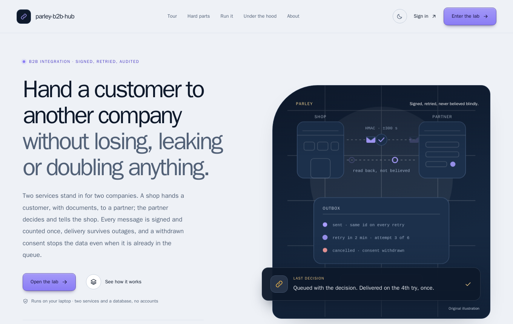
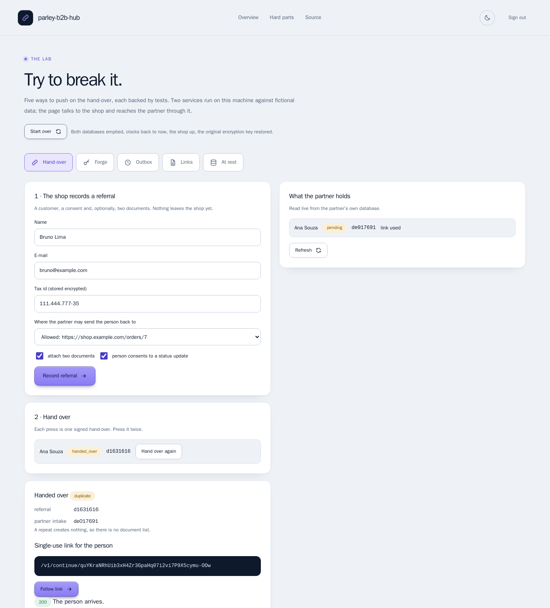
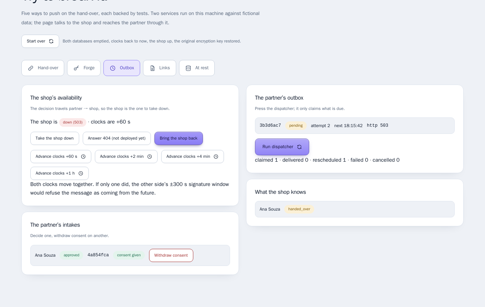
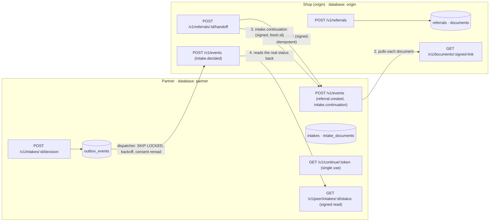
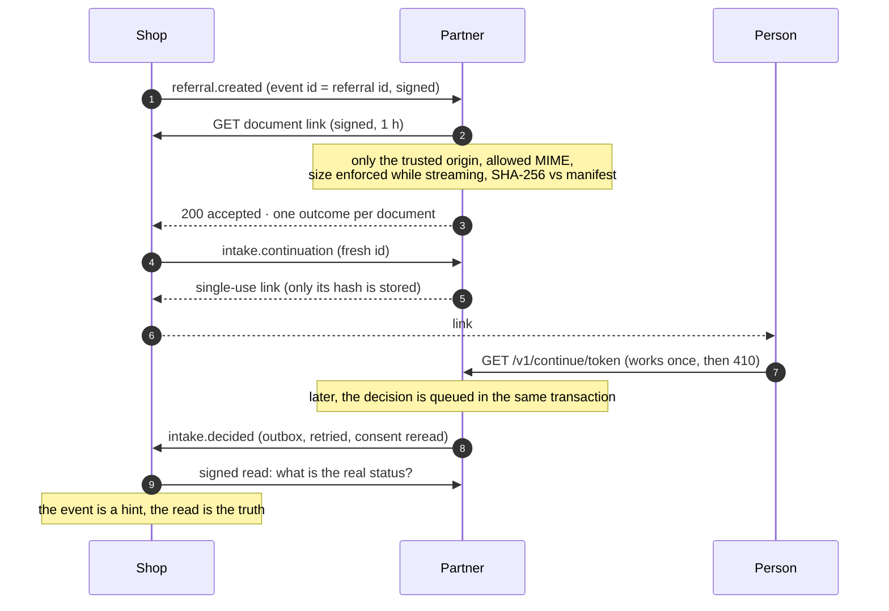

# parley-b2b-hub

> Hand a customer to another company **without losing, leaking or doubling anything.** Two services stand in for two
> companies: every message is **signed and counted once**, delivery **survives outages**, and a **withdrawn consent stops
> the data even when it is already in the queue**.

[](https://github.com/MenoDK/parley-b2b-hub/actions/workflows/ci.yml)


%20·%2020%20browser%20·%2016%20mutants%20caught-success)




## Run it in a minute

You need **Docker** (Compose v2), `make` and `openssl`. No API keys and no accounts; nothing is sent anywhere.

```bash
git clone https://github.com/MenoDK/parley-b2b-hub.git
cd parley-b2b-hub
make demo            # writes .env with fresh random secrets, builds one image, starts the shop, the partner and PostgreSQL
```

Open **http://localhost:8000**. The page explains the project and links to the **lab**, where every hard part below can
be tried in a browser. The lab's sign-in pre-fills the development key (`change-me`).

The partner's own API is on http://localhost:8001. Both ports are published on loopback only, so the demo key is never
reachable from your network. Stop with `make down`; `make reset` also deletes the databases.



*Above: the second hand-over is answered `duplicate` and creates nothing at the partner. The first link was replaced the
moment the second existed; the new one works exactly once.*

## What to try

Each row is a claim that is easy to make and hard to get right. The lab has a **Start over** button between attempts.

| Try to… | In the lab | You should see |
|---|---|---|
| **Hand over twice** | Hand-over → *Record referral* → *Hand over* → *Hand over again*. *Follow link* on the older card, then on the newer one, then on the newer one again. | `duplicate`, one intake at the partner. The old link: **410**. The new link works once; the second visit is the same 410 as a link that never existed. |
| **Lie with a valid signature** | Forge → *Decision (a lie: approved)* → *Send valid* | Accepted, but `applied: pending`, `mismatch: true`. The shop read the real status from the partner and counted the lie. |
| **Forge, replay, back-date** | *Send again*, *Tamper with the body*, *Back-date the timestamp*, *Wrong secret*, *No signature* | `duplicate`, then four `401`s with the **same** body: the response is not an oracle for which check failed. |
| **Take a company down** | Outbox → *Take the shop down* → *Approve* → *Run dispatcher* → *Advance clocks* → repeat → *Bring the shop back* | Attempts 1, 2, 3 waiting 60, 120, 240 s; nothing claimed when you run early; then `sent`, one inbox row, one event id. |
| **Withdraw consent mid-queue** | Same, then *Withdraw consent* before bringing the shop back | The row becomes `cancelled_by_revocation` (not `failed`) and the shop is never told. |
| **Steal a document link** | Links → *Mint a link* → *Fetch*; then *Change the expiry*, *Flip a signature character*, *Advance the shop's clock 2 h*, *Revoke* | One `200`; everything else the same `403`. The reasons are only in the access log. |
| **Point it at your network** | Forge → *Referral with a document on another host* → *Send valid* | Accepted, document `rejected: url_not_allowed`. The partner never opened a connection. |
| **Lose the key** | At rest → *Add a new key* → *Drop old keys* (then *Start over* and rotate first) | `unreadable` rows after the drop; all readable if you rotated first. The blind index never changed. |



*Above: the shop is down. The decision is queued, attempt 2 failed with `http 503`, the next try is scheduled.*

Prefer the terminal? Everything is an HTTP API (management routes take `x-api-key: change-me`):

```bash
API=http://localhost:8000; KEY='x-api-key: change-me'
ID=$(curl -s $API/v1/referrals -H "$KEY" -H 'content-type: application/json' -d '{
  "customer": {"name": "Ana Souza", "email": "ana@example.com", "taxId": "529.982.247-25"},
  "consent": {"statusBack": true},
  "returnUrl": "https://shop.example.com/orders/7",
  "documents": [{"kind": "proof", "filename": "a.pdf", "mime": "application/pdf", "contentBase64": "JVBERi0xLjQKJSB0ZXN0CiUlRU9GCg=="}]
}' | python3 -c "import sys,json; print(json.load(sys.stdin)['id'])")
curl -s -X POST $API/v1/referrals/$ID/handoff -H "$KEY"        # the second time: "duplicate": true
curl -s $API/v1/lab/peer-state -H "$KEY" | python3 -m json.tool | head -30   # the partner's database, read live
```

### Run the checks

```bash
docker compose -f compose.dev.yml up -d --wait       # a PostgreSQL for the tests (127.0.0.1:15433)
make install && make check                           # biome, tsc --strict, 74 tests (38 of them on real PostgreSQL)
make mutate                                          # breaks each of 16 critical rules on purpose; a test must notice
make e2e                                             # Playwright + axe in a container, against the same stack as `make demo`
```

The 38 tests that need a database are reported as *skipped* when `DATABASE_URL` is not set; the Makefile sets it to the dev compose database, and CI runs them against a PostgreSQL service.

## What it is

A shop wants to hand a customer, with documents, to a partner. The partner decides and tells the shop. Between two
companies that is harder than it sounds: a request can arrive twice, or never, or be forged, or be true and still wrong; a
person can withdraw their permission while a message is waiting; a link can be forwarded; a key can be lost.

`parley-b2b-hub` is the smallest realistic system that has to get all of that right, built as two instances of one
codebase (`ROLE=origin` and `ROLE=partner`) talking over HTTP, each with its own database, so neither can cheat by reading
the other's tables. It is deliberately not a framework: each guarantee is a small module with a test that tries to break it.

## Architecture



### What happens to a hand-over



## Design decisions

Each has a record with the alternatives that lost: [docs/adr](docs/adr/README.md).

| Decision | Why | ADR |
|---|---|---|
| Sign `id.timestamp.raw bytes`; one generic 401 for every refusal | Id, time and content each need to be bound; the reason is a hint to a forger | [0001](docs/adr/0001-signed-envelope.md) |
| Claim the event id in the handler's transaction; reply after COMMIT | Check-then-set races; "accepted" must never describe a rollback | [0001](docs/adr/0001-signed-envelope.md) |
| Outbox row in the decision's transaction; `FOR UPDATE SKIP LOCKED`; stable event id | No lost or phantom events; two dispatchers never collide; retries can be de-duplicated | [0002](docs/adr/0002-outbox-and-consent-at-send-time.md) |
| Reread consent when the event leaves | "Withdraw at any time" must not mean "until the queue runs" | [0002](docs/adr/0002-outbox-and-consent-at-send-time.md) |
| Hand-over = idempotent call + a call that mints the link | A replayed capture must not yield a working link | [0003](docs/adr/0003-handover-is-two-calls.md) |
| Our own signed, audited, revocable document links; validate on the receiving side | Audit, instant revocation, no SSRF, no trust in the manifest | [0004](docs/adr/0004-signed-document-links.md) |
| Versioned AES-256-GCM + a blind index under a separate key; rotation as a process | Find a person without decrypting a table; replace a key without downtime | [0005](docs/adr/0005-vault-and-blind-index.md) |
| A lab mode the settings validator refuses in production | Make failure visible without a way to ship the switches | [0006](docs/adr/0006-a-lab-mode-that-cannot-reach-production.md) |

## Technical resources demonstrated

| Area | Where to look |
|---|---|
| Webhook security: HMAC over id, time and raw bytes, replay window, constant-time compare, secret rotation | `src/lib/signing.ts`, `test/signing.test.ts`, `test/trust.test.ts` |
| Idempotent receiver in one transaction (savepoint for rejected content, reply after COMMIT) | `src/lib/inbox.ts` |
| Transactional outbox: `SKIP LOCKED`, lease, backoff, consent reread, "do not claim when unconfigured" | `src/lib/outbox.ts`, `test/outbox.test.ts` |
| Defence against SSRF, open redirect, link reuse and oracle leaks | `src/partner/routes.ts`, `src/lib/return-url.ts`, `src/lib/document-links.ts` |
| Field encryption, blind index, key rotation | `src/lib/vault.ts`, `test/vault.test.ts` |
| PostgreSQL by hand: partial indexes, claims, savepoints, schema-per-test isolation | `src/db.ts`, `test/harness.ts` |
| Tests that start both services and a real database; mutation checking of the rules | `test/*.test.ts`, `scripts/mutation-check.mjs` |
| A landing page whose sample output is recorded from the running code and checked by a test | `scripts/record-transcripts.ts`, `test/transcripts.test.ts` |
| Browser tests with WCAG A/AA scans in light and dark, on the real stack | `e2e/` |
| Container hardening: multi-stage, non-root, read-only filesystem, `cap_drop: ALL`, health-gated Compose | `Dockerfile`, `docker-compose.yml` |
| Documentation as code: a map, handoff, checklist, ADRs, enforced by `docsguard` | `docs/`, `CLAUDE.md`, `AGENTS.md`, `.claude/` |

### Bugs found while building this (each is now a regression test)

- A signed document link is 112 characters and the router's default limit for a path parameter is 100, so a *valid* link
  answered "no such route". Only a request against the real service showed it (`test/handoff.test.ts`).
- `SITE_DIR=/app/site` was joined onto the working directory (`/app/app/site`): the page 404'd in the container and passed
  every unit test. A test now serves the site with an absolute path (`test/site.test.ts`).
- Found while wiring Compose, before it ever ran: the partner would have fetched documents from `localhost:8000`, which for
  the partner's container is itself. The address a *person* uses and the address the *other server* uses are now two
  settings (`PUBLIC_URL`, `SERVICE_URL`), with a test.
- Removing `SKIP LOCKED` survived a "three dispatchers at once" test, because the connections never overlapped. The test
  now holds a row lock and requires the batch to return (`make mutate` proves it fails without the clause).
- Found while designing the lab: after "Drop old keys" the shop's list would have answered 500 for rows it could no longer
  decrypt; it now says `(unreadable: key not available)` and refuses only the hand-over of that row.
- The tour inserted `<id-1>` as HTML and the placeholder vanished from the screen; the recorder now escapes everything and
  a browser test requires the placeholder to be visible.

## Project layout

```
src/
  app.ts                 composition root: builds both roles, mounts routes, starts the dispatcher
  config.ts              the only reader of the environment; refuses unsafe combinations
  db.ts                  schemas (shared, origin, partner), migration, transactions
  lib/                   signing · inbox · outbox · consent · vault · document-links · return-url · peer · audit · http
  origin/ partner/       the routes and event handlers of each role
  lab/routes.ts          lab mode (off by default, refused in production)
site/                    landing page and lab UI: plain JS and CSS, strict CSP, no build step
test/                    unit tests, and integration tests that start both services on a real PostgreSQL
e2e/                     Playwright + axe, run against the Compose stack
scripts/                 record-transcripts (landing page output) and mutation-check
docs/                    map, handoff, checklist, decision records
```

## Configuration

Everything comes from environment variables, validated at start-up (`src/config.ts`); `.env.example` lists them with
placeholders and `make env` writes a real `.env` with fresh random values. The service **refuses to start** when
`LAB_MODE` is on with `APP_ENV=production`, when the default API key is used in production, when the hand-over timeout is
not longer than the document-fetch budget, or when a secret or key is missing or malformed.

## Limitations and what I deliberately left out

- **Documents are stored in PostgreSQL (`bytea`)** to keep the demo to one dependency. Production would use object storage
  behind the same signed links; the manifest and the links do not change.
- **One API key per service**, no accounts or tenants (those live in a different project). The lab shows the same sign-in
  screen and fills the development key in.
- **The reverse status read happens inside the handler's transaction.** It is bounded by a timeout and a failure rolls
  the transaction back so the sender retries, but a slow partner holds a connection. A queue-then-confirm design is the next step.
- **Signed reads are protected by a one-time request id**, not by a payload hash or a binding to the response. Fine for
  "what is the status"; not enough for anything that returns secrets.
- **No retention** for `inbox_events`, `audit_log` and `document_access`; they grow without bound.
- **The dispatcher is a timer in each process.** Correct with several instances (that is what `SKIP LOCKED` is for), but a
  dedicated worker would scale it separately.
- **A key per tenant and a managed key service** are the production step for the vault; here one key ring per company.
- **GitHub Actions has been linted (actionlint) but never run on GitHub.**
- The demo's `localhost` stack publishes loopback only. Do not expose it: the lab exposes secrets by design (ADR 0006).

## Working with an AI coding session

The repository carries the documentation system I use to keep an AI coding session cheap and controllable: a one-screen
[map](docs/00-READ-FIRST.md), a [handoff](docs/HANDOFF.md) rewritten at the end of every session, a
[checklist](docs/CHECKLIST.md), decision records, a short `CLAUDE.md` / `AGENTS.md` contract, and `docsguard` to keep them
true. `docsguard check` is part of the definition of done.

## License

MIT, see [LICENSE](LICENSE).
